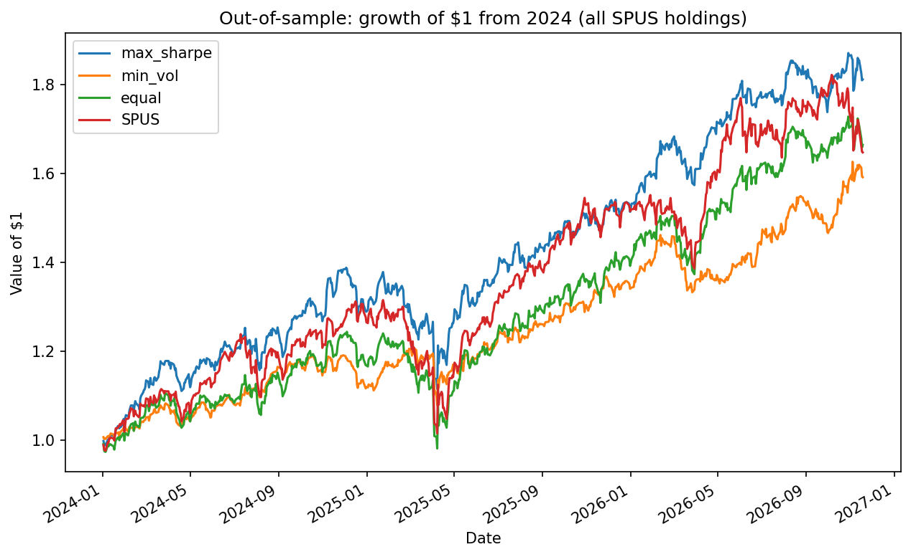

# Shariah-Compliant Portfolio Optimiser

SPUS is an ETF that holds the Shariah-compliant part of the S&P 500. This project asks a simple question: can you beat it by choosing the weights yourself instead of just buying the fund?

To find out, the project builds a portfolio optimiser in Python and tests it on every stock SPUS holds. The rules are strict: no shorting, no leverage, and nothing outside SPUS's own holdings.

## How it's set up

The full SPUS holdings list was downloaded from the SP Funds website on 19 November 2026. It has 215 stocks. Nine were dropped because they don't have enough price history going back to 2020. Most are recent spin-offs or listings, like GE Vernova, Sandisk, Constellation Energy and DoorDash. That leaves 206 stocks.

Price data comes from Yahoo Finance and starts in January 2020, since SPUS only launched in December 2019.

Four portfolios are compared:

- **Max Sharpe:** the mix with the best return for the risk taken
- **Min volatility:** the steadiest mix possible
- **Equal weight:** the same amount in every stock, with no optimisation at all
- **SPUS:** just holding the ETF

Each stock is capped at 2%, so the optimiser can't pile everything into a few names.

The most important part is testing it fairly. If you optimise on 2020 to 2026 and then check how it did over 2020 to 2026, it will always look great, because it's marking its own exam. So the optimiser only sees 2020 to 2023. The weights are then locked and tested on 2024 to November 2026, a period it has never seen.

## Results

Results from the test period (2024 to Nov 2026):

| | Max Sharpe | Min vol | Equal weight | SPUS |
|---|---|---|---|---|
| Annual return | 21.9% | 16.9% | 19.1% | 19.1% |
| Volatility | 15.6% | 11.6% | 16.6% | 18.5% |
| Sharpe ratio | 1.41 | 1.45 | 1.15 | 1.03 |
| Worst drawdown | -19.7% | -10.6% | -21.1% | -22.8% |

The max Sharpe portfolio beat SPUS, and it did so with less risk, not more. It returned 21.9% a year against 19.1%, with lower volatility. $1 invested at the start of 2024 grew to about $1.81, compared with about $1.65 in SPUS.

The min volatility portfolio is the most interesting result. It made slightly less than SPUS, but its worst drop was about half as bad (-10.6% vs -22.8%), and it ended up with the best Sharpe ratio of the four. It stands out in the chart during the April 2025 sell-off: everything else fell hard and it barely moved.

Equal weight earned exactly the same return as SPUS with less volatility. A likely reason is that SPUS is heavily concentrated in a handful of big tech names, while equal weight spreads the risk out.

All three strategies had smaller drawdowns than SPUS.

## How the top-100 version overstated the results

The first version of this project only used the 100 largest SPUS holdings, with a 5% cap. Those results looked far better:

| Max Sharpe vs SPUS | Top 100 | All 206 stocks |
|---|---|---|
| Annual return | 34.9% vs 19.1% | 21.9% vs 19.1% |
| Sharpe ratio | 1.88 vs 1.03 | 1.41 vs 1.03 |

Widening it to every holding shrank the edge from about 16 percentage points a year to about 3. The reason is that today's top 100 are mostly companies that became big because they did well, so picking them is quietly picking winners with hindsight. The full list gives a more honest answer, which is why it's the main result here.

## Limitations

This is still not a perfect test:

- It uses today's SPUS holdings. Any company that left the fund between 2020 and 2026 isn't included, which makes the results look better than they would have in real time.
- The backtest rebalances every day and ignores trading costs. A real portfolio would rebalance less often and pay fees.
- The Sharpe ratios don't subtract a risk-free rate.
- Estimating how 206 stocks move together from 4 years of data is noisy. That's the main reason for the 2% cap.
- The weights are set once at the end of 2023 and never updated.

This is a learning project, not investment advice.

## Next steps

- Re-optimise every quarter instead of once
- Add trading costs and monthly rebalancing
- Use the holdings SPUS actually had at each point in time, to remove the survivorship bias
- Test Shariah-compliant factor strategies like momentum and low volatility

## Tools

Python (pandas, NumPy, SciPy, Matplotlib), yfinance and Google Colab.
